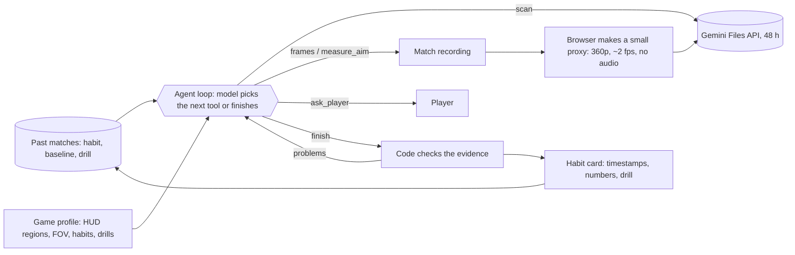

# Thirdeye: architecture plan

> Oct 18, 2026: game profiles are gone. Each game is learned from its recording (`learn.js`), and measuring is done by genre in code (shooters; chess with `chess-reader.js` and Stockfish). README.md describes the current design; this plan is the original one, kept for its reasoning.

Thirdeye watches a recording of your match after it ends, finds the one habit costing you the most fights, shows you the moments that prove it, gives you a drill, and checks your next matches to see whether it's improving.

The input is recorded gameplay video, so the agent works for almost any game. Valorant is the first game, done deeply. Other games are added as data, not code.

## Shape



- The model gets the goal, the tools with their costs, the budget, the game profile, and the player's history. The prompt never lists an order of steps.
- The loop is the shared `runAgent` in `gemini.js`, copied in from `hackathon/shared/` like the other apps. It runs on Flash-Lite models only.
- Everything runs in the browser, like the other apps. During development, hackathon's `npm run dev` already serves `/thirdeye/` and makes its `env.js` from `thirdeye/.env`.

## Tools

| Tool | What it does | Cost |
|---|---|---|
| `scan({from, to})` | A separate Gemini call watches that part of the proxy at 1 fps and returns events with MM:SS times: rounds, kills, deaths, who traded. | ~66 tokens per second of video watched (measured). 0 looks. |
| `frames({t, span, fps, region})` | Grabs frames from the original video in the browser (Mediabunny on WebCodecs). `region` names a part of the screen from the game profile, such as `center`, `minimap`, or `killfeed`. Returns them as images. | 1 look. 0 API calls. |
| `measure_aim({t, more})` | Gemini draws a box around the enemy head nearest the crosshair in a center crop, for up to 6 moments in one call. Code converts the gap to the screen center into degrees using the game's FOV (Valorant: 103° horizontal). | 1 look per moment. 1 call. |
| `ask_player({question, t})` | Shows the clip at `t` and pauses the run until the player answers. | Waits on the player. |
| `notes` on every tool | Records theories as testing, supported, or dropped, with timestamps, alongside the next step (Oct 17: a separate `note` tool cost a turn each, 4 to 6 of a run's 14 to 17). | Free. |
| `finish({habit, evidence, drill, recheck})` | Ends the run. Code sends it back with the problems when something fails a check (see below). | Ends the run. |

Two rules keep the cost bounded:
- The full video never enters the agent's own context, because each turn resends the history and 30 turns of a 30-minute video would be millions of tokens. Only `scan`'s text result goes in.
- Frame images stay in the history for one turn. After that, code replaces them with the agent's written observation. `runAgent` needs one change for this: a tool can return images.

## Who decides what

| The agent decides | Code enforces |
|---|---|
| Which parts of the match to scan, and which duels to look at closely | The budget: looks, turns, and tokens. Every tool result shows what's left. |
| Which theory to test, when the evidence drops it, and what to test next | The aim math: pixels to degrees, and the crosshair at the screen center |
| When to ask the player, and what to ask | `finish` needs at least 3 evidence timestamps, and the agent must have actually looked at each one |
| Which one habit matters most, and the drill for it | Post-game only. Thirdeye never reads game memory and never runs while you're playing. |
| How to re-check the current habit in a new match | Which habit is current, and what the baseline was (stored history) |

## Game profile (`eval/answer-keys/valorant.json`)

The profile gives HUD regions as fractions of the screen (kill feed, minimap, round timer), the FOV, and a short list of habits with a drill for each:
- crosshair low
- wide peek
- re-peeking the same angle
- shooting while moving
- spraying at long range

These are background knowledge, not steps. The agent may name a habit that isn't on the list. Adding a game means writing a profile. With no profile, the agent still works, but only with full-frame looks.

## Memory across matches

Saved in `localStorage` on the device: the current habit, its baseline measurement (for example "crosshair 1.4° below the head, 9 duels"), the drill, and one line per match. The next run starts from this, which is how the targeted re-check works.

## Definition of Done

1. Upload a 20–40 minute Valorant match and get one habit with at least 3 timestamps, measured numbers where they apply, and a drill.
2. The theory board shows every theory the agent tested, including the ones it dropped.
3. The next match's run re-checks the current habit and reports better, same, or worse against the baseline.
4. Nothing is sent to Gemini except the silent proxy and the frames the agent looks at. Voice comms never leave the device.

## Evaluation

- **Planted habits.** Record deathmatch or custom games, each with one habit played on purpose (aim at the floor, always peek wide), plus clean controls with no planted habit. Score whether the agent names the planted habit and how often it flags a habit on a clean control.
- **Agent vs. fixed pipeline at the same budget.** The pipeline scans, measures every death, and reports. It uses the same tools and the same number of looks.
- **Agent vs. Gemini's own agentic video mode.** Gemini's video API has an agentic mode (Interactions API, supported on 3.5 Flash-Lite) that chooses where to look by itself. Give it the same recordings with one prompt. This answers "why not just ask Gemini?"
- **Aim accuracy.** Compare `measure_aim` with hand-placed head positions on about 50 frames, and report the median error in degrees.
- **Paths really differ.** Log every tool sequence. If they're nearly identical across 20 matches, it's a workflow, and EVALUATION.md says so.

## Test these first

Three assumptions decide the design. All three passed on the synthetic match on Oct 16 (details in README.md, under Tests); none has been checked on real Valorant footage yet.

| Assumption | Pass bar | If it fails |
|---|---|---|
| Flash-Lite at 1 fps finds kills and deaths from the kill feed | ≥ 90% found against a hand-made timeline on 2 matches, within 2 s | Find kill-feed changes in code by comparing pixels between frames (free, but needs the HUD region) |
| Flash-Lite can box a head precisely enough to tell head from chest | Median error ≤ 0.5° on 30 hand-labeled frames (head to chest is roughly 1° at typical range) | Measure in coarser buckets (head, neck, chest, body) and say so |
| The browser can make the proxy and upload it | A 30-minute match becomes a proxy under 100 MB in under 3 minutes, and the upload succeeds from the page | Send the proxy inline if it's under the size limit, or relay it through the local dev server |

## Files

```
index.html  app.js  styles.css   UI: upload, one spinner with one status line, timeline, theory board, verdict
agent.js                        system brief, tools, budget, finish checks
video.js                        proxy, frame grabs, Files API upload (Mediabunny)
core.js                         pure logic: aim math, finish checks, budget, history; unit tested
eval/answer-keys/valorant.json             game profile
gemini.js                       copied from hackathon/shared/
scripts/dev.mjs                 dev server
tests/                          unit tests, browser test with Gemini mocked, live check, fixture maker
```

Thirdeye is its own repository with its own `package.json`. Playwright is listed there but not installed; the tests use the copy in `hackathon/node_modules`.

## Limits and rules

- **Post-game only.** Live advice, overlays during play, or reading game memory would break Riot's rules and risk anti-cheat flags.
- **Video limits.** Low bitrate, unusual HUD settings, or a crosshair placed off-center hurt detection. Report these failures honestly.
- **Free-tier quota.** Each turn is one request. Oct 17 reviews took 23 to 49 calls (turns, kill-feed reads, one call per aim moment, retries); the turn cap is now 12 and reads are batched, so an eval of 20 matches still needs spreading across days. Save each run's log.
- **Files API.** Files are deleted after 48 hours (that's fine, since the proxy is rebuilt from the original) and are limited to 2 GB each on the free tier.
