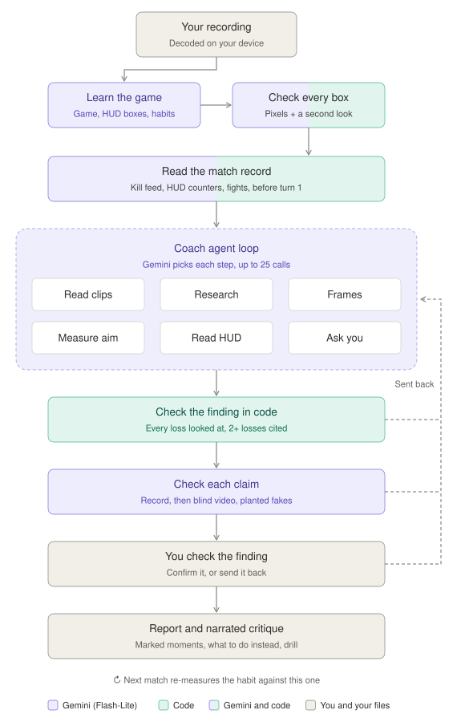

# Eye Catcher

A post-game coach for any game. Drop in a recording of your match. It finds the one habit that's losing you games, shows you the moments that prove it with what to do instead at each one, and gives you a drill. In your next match it checks whether the habit got better.

## The problem

Most players lose to the same few habits, match after match, and don't see them. Watching your own replay takes as long as the match did, and you have to know what to look for. A coach knows, but most players don't have one.

Giving the video to an AI model doesn't fix that. On Oct 17 our first version reviewed the first 14 minutes of one Valorant match three times and named three different habits. Checked frame by frame, none of them held. Models guess numbers, mix up players, and call a teammate an enemy, and they sound just as sure when they're wrong.

## How Eye Catcher solves it

- It learns each game from the recording: what's on the HUD, where the kill feed is, how a death looks. There's no game profile to write.
- Code measures everything it can: the kill feed, the HUD's numbers, health, ammo, aim, and every chess move, scored by Stockfish. The model isn't asked for a number code can read.
- An agent decides where to look closely, within 25 model calls a review. Nobody gives it a list of steps.
- Every claim is checked twice before you see it: against the match record, and against the video by a check that never sees the coach's reasoning.
- You confirm it. A finding comes to you before it's final, and whatever you say goes back to the coach.
- The report marks up each moment on its own frame, with what to do instead, a drill, and a narrated critique you can save as a video.

## Run it

There are three ways. All three need a free Gemini API key.

| | What you do | What you get |
| --- | --- | --- |
| 1. The website | Open a link, paste your key | The coach in your browser. Nothing to install. |
| 2. Download the app | Install it, paste your key | Everything, with a voice that runs on your computer. |
| 3. From source | Clone, install, run | Everything, plus the tests and evals. |

### Get a Gemini API key

1. Go to https://aistudio.google.com/apikey and sign in with a Google account. You must be 18 or older, in a region where the Gemini API is available.
2. Choose Create API key.
3. Copy the key. You paste it into the app's Coach screen, or into `.env` when you run from source. It's sent only to Google.

The free tier costs nothing and allows about 500 requests a day per model. A review takes 15 to 25, so that's about 20 reviews a day. On the free tier Google may use what you send to improve its products, and people may read it ([Gemini API terms](https://ai.google.dev/gemini-api/terms)). Don't review recordings that show anything private.

### 1. The website

1. Open https://davidl72code.github.io/EyeCatcher/ in Chrome or Edge.
2. Go to Coach and paste your key. Your browser keeps it and sends it only to Google.
3. Drop in a recording (MP4, MOV, MKV, or WebM).

There's no server behind the website. Your recordings and reviews stay in your browser. Unlike the app, the critique uses your browser's voices, and a past review asks for its recording again.

To run the website copy on your own machine (needs Node.js 20 or newer and Python 3):

```bash
git clone https://github.com/DavidL72Code/EyeCatcher.git
cd EyeCatcher
npm run web
python3 -m http.server 8080 --directory site
```

Then open http://localhost:8080. `npm run web` uses only Node, so there's nothing to install first.

To put your own copy on GitHub Pages: fork the repo, set Settings › Pages › Source to GitHub Actions, and push to `main`. `.github/workflows/pages.yml` builds and deploys it.

### 2. Download the app

1. Get the installer for your system from the [latest release](https://github.com/DavidL72Code/EyeCatcher/releases/latest):

   | System | File |
   | --- | --- |
   | Mac with Apple silicon (M1 or later) | `Eye-Catcher-<version>-mac-arm64.dmg` |
   | Mac with Intel | `Eye-Catcher-<version>-mac-x64.dmg` |
   | Windows 10 or 11 | `Eye-Catcher-<version>-win-x64.exe` |
   | Linux | `Eye-Catcher-<version>-linux-x86_64.AppImage` |

2. Install it. The installers aren't signed with a paid certificate yet, so each system warns you the first time.
   - macOS: open the `.dmg` and drag Eye Catcher into Applications. The first launch is blocked. Go to System Settings › Privacy & Security, find "Eye Catcher was blocked", and choose Open Anyway. Or run this once:
     ```bash
     xattr -dr com.apple.quarantine "/Applications/Eye Catcher.app"
     ```
   - Windows: run the `.exe`. If SmartScreen stops it, choose More info, then Run anyway.
   - Linux: make the file runnable, then open it:
     ```bash
     chmod +x Eye-Catcher-*.AppImage
     ```
3. Open Coach, paste your key, and drop in a recording.

The app keeps your key encrypted in the system keychain (the macOS Keychain, Windows DPAPI, or the Linux keyring). The voice model, Kokoro (about 90 MB), downloads the first time a critique plays. Each release lists every installer's SHA-256 in `SHA256SUMS.txt`, to compare with `shasum -a 256 <file>`.

### 3. From source

You need Node.js 20 or newer and git.

```bash
git clone https://github.com/DavidL72Code/EyeCatcher.git
cd EyeCatcher
npm install
cp .env.example .env
```

On Windows, use `copy .env.example .env`. Open `.env` and put your key after `GEMINI_API_KEY=`. Then start the desktop app:

```bash
npm run desktop
```

Or run it in your browser at http://localhost:5177/:

```bash
npm run dev
```

Home's demo clips aren't in the repo, since they're cut from other players' videos. `npm run scenes` makes them from recordings on your machine.

## What we built

| Part | What it does | Where |
| --- | --- | --- |
| The app | Home, Coach, and Past reviews. While a review runs, the video follows the coach and each step shows as a card. | `index.html`, `app.js`, `styles.css` |
| Learning a game | Names the game and boxes its HUD from 8 frames, checks every box, and measures the kill feed's colors in code. | `learn.js` |
| Readers in code | The kill feed, the HUD's counters, ammo, aim geometry, and chess moves scored by Stockfish. | `learn.js`, `video.js`, `core.js`, `chess-reader.js` |
| The coach | One Gemini agent loop with eight tools and a 25-call budget. | `agent.js`, `gemini.js` |
| The checks | The finish rules in code, the claim check against the record, and the check against the video. | `core.js`, `agent.js` |
| The report | Marked-up frames, what to do instead, a drill, and the narrated critique, saved as a video if you want. | `report.js`, `app.js` |
| Past reviews | Each review's log, report, and recording, kept in the browser. | `reviews.js` |
| Desktop app | Electron. Remembers where recordings are on disk, keeps the key in the keychain, and runs the Kokoro voice. | `desktop/`, `scripts/voice.mjs` |
| Website | A static copy for GitHub Pages. | `scripts/build-web.mjs` |
| Backend (optional) | Holds one key for other people to use, rate-limited. Nobody hosts one; you don't need it. | `server/index.mjs` |
| Evals | Answer keys written off the frames, the scorecard, and every loop's report. | `eval/`, `tests/evals/` |
| Releases | Builds the installers on a version tag and checks every file before it's published. | `.github/workflows/`, `build/` |

How each piece works, with the measurements behind it, is in [docs/how-it-works.md](docs/how-it-works.md).

## How the agent works



Purple steps are Gemini (Flash-Lite), green ones are code, and beige ones are you and your files. A step that's half of each uses both: code cuts the crops and checks the numbers, and Gemini reads them. A dashed line is a finding sent back to the coach.

1. The recording stays on your device. The browser decodes it, and only what a step needs goes to Gemini, with no sound. Voice chat never leaves your device.
2. One call looks at 8 frames and names the game, the genre, and what's on screen. A second call checks every box without being told what it's meant to be, and code drops the boxes that fail.
3. Before the coach's first turn, code builds the match record: every kill-feed line, the HUD's counters (K/D/A, score, health), and a second look at any death it isn't sure of. A game with no kill feed gets a low-detail pass over a small silent copy, checked against the HUD.
4. The coach gets a goal, its tools and what each costs, the budget, what it learned about the game, and your history in this game. It decides what to research and which moments to watch.
5. When it calls `finish`, code sends the finding back if any cited moment wasn't looked at closely, if it shows fewer than 2 losses, or if your losses weren't looked at first.
6. The claim check reads each claim beside the record. The video check sees only the claims, who you are, and the video. Up to two false claims are planted among them. A check that agrees with one runs again, and if it agrees again, it doesn't count.
7. You see the finding and decide. Then the report is built, and one call writes the critique's script, which code checks before it's used.

The coach's tools:

| Tool | What it does | Cost |
| --- | --- | --- |
| `scan` | Run by code before the coach starts: the kill feed, fights, and the windows worth watching. | 1 call per 32 kill-feed lines, plus the HUD reads |
| `read_clips` | Reads up to 4 of those windows as video: what happened, who engaged first, what decided it. | 1 call per 2 windows |
| `research` | Looks up what matters in this game and this character, from the web. | Free if done this week, else up to 10 calls |
| `frames` | Full-quality stills or a short clip around up to 3 moments. | 1 look per moment |
| `measure_aim` | Boxes the heads near the crosshair, and code turns that into head-heights and degrees. | 1 call |
| `read_hud` | Reads one HUD element (a clock, a counter, the score) at up to 8 moments. | 1 call |
| `ask_player` | Asks you one question about a moment. At most 3 a review. | Waits for you |
| `finish` | Ends the review with one habit, or with the biggest reason you lost when no habit repeats. | Checked in code |

## Tools and outside resources

| What | Used for | Where it runs |
| --- | --- | --- |
| Gemini 3.5 Flash-Lite, falling back to 3.1 Flash-Lite | The coach, the clip reads, both checks, and the critique's script | Google's API |
| Gemini 2.5 Flash-Lite with Google Search | Researching each game, its meta, and the character's kit | Google's API |
| Gemini Files API | The small silent copy for games with no kill feed. Google deletes it after 48 hours. | Google's API |
| [Mediabunny](https://mediabunny.dev) | Decoding the recording and cutting clips (WebCodecs) | Your device |
| [chess.js](https://github.com/jhlywa/chess.js) and [Stockfish 10](https://stockfishchess.org) | Legal moves and each move's score | Your device |
| [Kokoro](https://github.com/hexgrad/kokoro) (kokoro-js on onnxruntime) | The critique's voice in the desktop app | Your device |
| The browser's speech voices | The critique's voice on the website | Your device |
| [Motion](https://motion.dev) | The interface's motion | Your device |
| [Electron](https://www.electronjs.org) and [electron-builder](https://www.electron.build) | The desktop app and its installers | Your device |
| GitHub Actions, Releases, and Pages | Building the installers and hosting the website | GitHub |
| [Playwright](https://playwright.dev) and Chrome | The browser tests and the evals | Your device |
| [Render](https://render.com) (optional) | Hosting your own backend | Render |

All third-party code the page runs ships in `vendor/`, pinned, with its license and hash. Nothing loads from a CDN.

## When it's unsure, it asks you

It doesn't guess on the calls only you can make:

- Which player is you. When the kill feed can't tell, it plays a moment where your name shows and asks you to pick it, or type it. It keeps the answer for that game.
- Which side, and who you are, in footage of a whole match (a broadcast or a game film). The sides come as buttons, then you say who you are in your own words ("#16, the quarterback").
- A question the video can't answer. The coach can ask up to 3 a review. The app plays the moment and you tap an answer.
- The check-in. Before a finding is final, you see the habit, why, and the moments that show it. "Yes, that's it" makes it final. "Not really", or anything you type, goes back to the coach for one more look. If no turn is left, nothing is named rather than something you doubted.
- What to work on. You choose "Work on this" or "Not this", and the next review of that game checks it.
- Your files. The desktop app asks before it keeps copies of your recordings in its own folder.

What code can settle on its own (a missing field, a moment it can fill in from the record) it settles without asking you.

## Evaluation

### What we test

| Area | What's tested | How | Latest result |
| --- | --- | --- | --- |
| Logic | 237 unit tests: the finish rules, aim geometry, the kill-feed reader, chess reading and scoring, the claim-check rules, the backend's locks, the scorecard | `npm run test:unit` | 237 of 237 pass (Oct 25) |
| The app | 178 checks in Chrome on a synthetic match, with Gemini mocked: upload, scan, timeline, the finish checks, the report, past reviews, phone layout, no code from outside | `npm run test:e2e` | 178 of 178 pass (Oct 25) |
| Desktop app | 22 checks in Electron: recordings remembered across a restart, files you didn't give it refused, the key never in the page, the Eye Catcher folder | `npm run test:desktop` | 22 of 22 pass (Oct 25) |
| Chess reader | Moves read back off synthetic chess video, against a Stockfish truth file | `npm run test:chess-video` | All 64 plies, in order |
| Installers | Nothing private packed; each DMG verifies, opens, and keeps its signature; every file matches the sum taken where it was built | `build/check-pack.cjs`, `build/check-dmg.cjs`, `.github/workflows/release.yml` | v0.1.2: 4 of 4 installers pass (Oct 25) |
| Kill-feed reader | 41 kill-feed lines labeled by hand on a real Valorant match | `npm run eval` | 41 of 41 lines; all 9 kills and 6 deaths (Oct 20) |
| Match record | Deaths, kills, and goals on Rocket League, Marvel Rivals, and League clips, against truth read off the frames | `node eval/recordcheck.mjs` | Rocket League 4 of 4 goals to the right side; Rivals 1 of 1 death, 13 of 14 kills, none invented; League 2 of 2 deaths, no kills invented (Oct 22) |
| Video check | 25 claims labeled off the frames (15 true, 10 false), run twice | `node eval/verifycheck.mjs` | 30 of 30 true claims stood, 18 of 20 false ones stopped, 0 of 24 planted ones agreed with (Oct 22) |
| Research | Six games, scored against a checklist written before any answer | `node eval/researchcheck.mjs` | Coverage 47 of 57 to 55 of 57; errors 26 to 0 (Oct 20) |
| Shots | The ammo counter over 12 stretches labeled by eye | `node eval/shotprobe.mjs` | 12 of 12, none wrongly "no shots" (Oct 22) |
| Chess, real | A chess.com game recorded on a phone | By hand, against the move list | 52 of 52 plies, in order (Oct 24) |
| Whole pipeline | Learning, scan, aim, and a review on a synthetic match with a planted habit | `npm run test:live` | 7 of 8 kills and deaths within 2 s; aim error 0.27° median; found the planted habit in 12 calls |
| Whole reviews | Every review held against a coach's read of 33 losses in 9 games, frame by frame | `eval/scorecard.mjs` | Below |

### Whole reviews, loop by loop

The coach baselines in `eval/answer-keys/coach/` cover League of Legends, Rocket League, Marvel Rivals, Valorant, Clash Royale, Fortnite, Brawl Stars, chess, and Rainbow Six Siege. Each loop reviews every game 2 or 3 times in the desktop app, and every run is scored on the same card ([eval/SCORECARD.md](eval/SCORECARD.md)). From [tests/evals/README.md](tests/evals/README.md), Oct 25:

| Loop | Losses found in the record (higher is better) | Losses cited (higher) | Cited and explained right (higher) | Deaths and points invented (lower) | False claims caught (higher) | Calls a run | Prompt tokens a run |
| --- | --- | --- | --- | --- | --- | --- | --- |
| 37 | 40 of 55 (73%) | 19 of 55 (35%) | not graded | 6 of 22 (27%) | not graded | 18.7 | 244k |
| 38 | 26 of 48 (54%) | 15 of 48 (31%) | not graded | 3 of 9 (33%) | not graded | 18.9 | 262k |
| 39 | 45 of 66 (68%) | 25 of 66 (38%) | not graded | 7 of 33 (21%) | not graded | 23.1 | 351k |
| 40 | 37 of 61 (61%) | not counted | 10 of 61 (16%) | 14 of 33 (42%) | 17 of 22 (77%) | 18.1 | 264k |
| 41 | 22 of 46 (48%) | not counted | 9 of 46 (20%) | 5 of 12 (42%) | 13 of 16 (81%) | 21.0 | 298k |

Loops 38 and 41 ran fewer games: in loop 41, 6 of 18 runs (Rocket League, Marvel Rivals, Valorant) had most of their calls refused by the quota and don't count. Each loop's card, report, and grades are in `tests/evals/`.

## What worked and what didn't

### What worked

- Readers written in code held up: 41 of 41 kill-feed lines, 52 of 52 chess plies off a phone recording, 12 of 12 ammo stretches. Before the kill-feed reader, the scan found 1 to 4 of the player's 9 kills.
- The video check. It let 30 of 30 true claims stand, stopped 18 of 20 false ones, and agreed with none of the 24 planted. In loops 40 and 41 the checks caught 17 of 22 and 13 of 16 false claims.
- Research. Coverage of what decides each game went from 82% to 96%, with no errors left.
- The same match takes the same path. At temperature 0, three reviews of one Apex match on Oct 19 came out identical, down to 263,008 prompt tokens each.
- Cost. Loop 41 averaged 21 calls and 298k prompt tokens a run, about $0.20 at 3.5 Flash-Lite's list price, and nothing on the free tier.

### What didn't

- Explaining the loss. The coach named what decided a loss in 16% of them (loop 40) and 20% (loop 41).
- Coverage. In loops 37 to 39 the coach cited only 31% to 38% of the baseline losses.
- Invented deaths and points: 14 of 33 in loop 40, 5 of 12 in loop 41.
- Who the player is. Loop 41 got the player's name right in 4 of 12 runs.
- Good claims thrown out. In loop 41, 7 of the 20 claims the checks sent back were true.
- The quota. Loop 41 lost 6 of 18 runs to refused calls, and a review that falls back to 3.1 Flash-Lite can take 10 to 20 minutes.

### Failures we hit

Each has a fix in the code. [tests/evals/ledger.md](tests/evals/ledger.md) says which are proven on their own case.

- Clash Royale: it took the opponent's name for the player's, and called a 0-1 loss a win (Oct 24).
- League: the low-detail pass gave the player 22 kills, every one of them a minion (loop 40; true: 0).
- Brawl Stars: a review ended "nothing lost" after 3 calls, on a match with 2 deaths (loop 40).
- Habits judged by eye: on Oct 18, 2 of the 3 habits it named were false. Apex's "reloading in the open" cited moments that were healing and riding ziplines.
- The first release: v0.1.0's Mac download was corrupt. Each Mac runner built both DMGs, and their copies landed on one path. v0.1.2 fixed it, and the release now checks every file before it's published.

### Limitations

- Post-game only. It never reads game memory and never runs during a match.
- Shooters and chess have readers in code. Any other game gets the generic tools: close looks, HUD reads, questions, and the checks.
- With no kill feed, the scan reads one frame a second at low resolution, so a short fight can be missed.
- Aim math breaks on stretched resolutions, a crosshair moved off center, or heads under 6 px.
- Learning varies from call to call, and a box can land beside the number it's meant to read.
- Google Search often fails on a free key, and research then falls back to the model's own knowledge. The app says when that happens.
- A free key covers about 20 reviews a day.
- The installers aren't signed with paid certificates, so macOS and Windows warn on first launch.
- The website has no Kokoro voice and doesn't remember where your recordings are.
- The eval recordings are other players' footage and aren't in the repo, so the loops can't be rerun as they are.

The full list is in [docs/how-it-works.md](docs/how-it-works.md#limits-in-full).

## Run the tests and evals yourself

### Tests, no API key

The fixtures and browser tests drive Google Chrome. Set `CHROME` to its path if it isn't in the default Mac location.

```bash
npm install
npm run fixture
npm run fixture:chess
npm run test:unit
npm run test:e2e
npm run test:desktop
npm run test:chess-video
```

`npm run fixture` makes a 2.5-minute synthetic shooter match, and `npm run fixture:chess` two synthetic chess games, one with blunders planted under time pressure. Both go in `tests/fixtures/`, which git ignores. `npm test` runs the unit tests and the browser test together.

### Evals that call Gemini

Put your key in `.env` first. Each one spends real requests from your daily allowance.

```bash
npm run test:live
```

The whole pipeline on the synthetic match: learning, the scan, aim, and a full review, about 25 requests. It prints what each piece measured against the fixture's truth.

```bash
npm run eval -- match
```

Runs the agent, a fixed pipeline, and Gemini's own agentic video mode on the synthetic match, and scores each against the planted habit (about 27 requests). `npm run eval -- chess` does the same on the chess games. `EVAL_MAX_CALLS` caps the calls per recording (default 80).

```bash
node eval/researchcheck.mjs
```

Researches six games and scores the answers against `eval/research-checklist.json`. About 10 requests a game. `GAMES="Valorant,Rocket League"` runs fewer.

### Your own recordings

1. Play a match with one habit on purpose (aim at the floor, always swing wide), or a normal one as a control.
2. Put the file in `eval/recordings/`. Git ignores that folder.
3. Add it to `eval/recordings.json` with the habit you played, or `null` for a control. The fields are in [eval/README.md](eval/README.md).
4. Run it, by any part of its file name:
   ```bash
   npm run eval -- my-match
   ```

To score whole reviews the way the loops are scored, write a baseline for your clip like those in `eval/answer-keys/coach/`, then:

```bash
node eval/scorecard.mjs <loop dir> <name>
node eval/scorecard.mjs compare <a> <b>
```

The first writes the card for one loop's runs, and the second compares two loops on the games valid in both. How each row is graded is in [eval/SCORECARD.md](eval/SCORECARD.md). The harness that runs a loop's reviews in the desktop app isn't in the repo yet.
